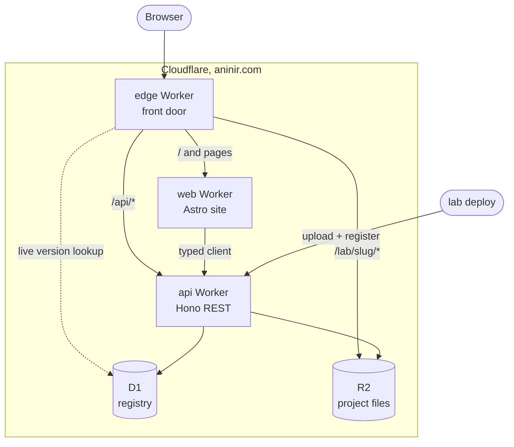
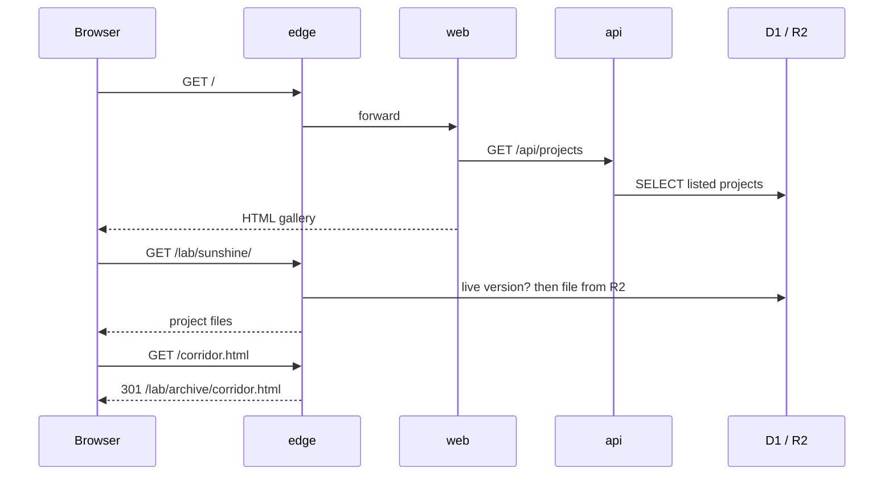
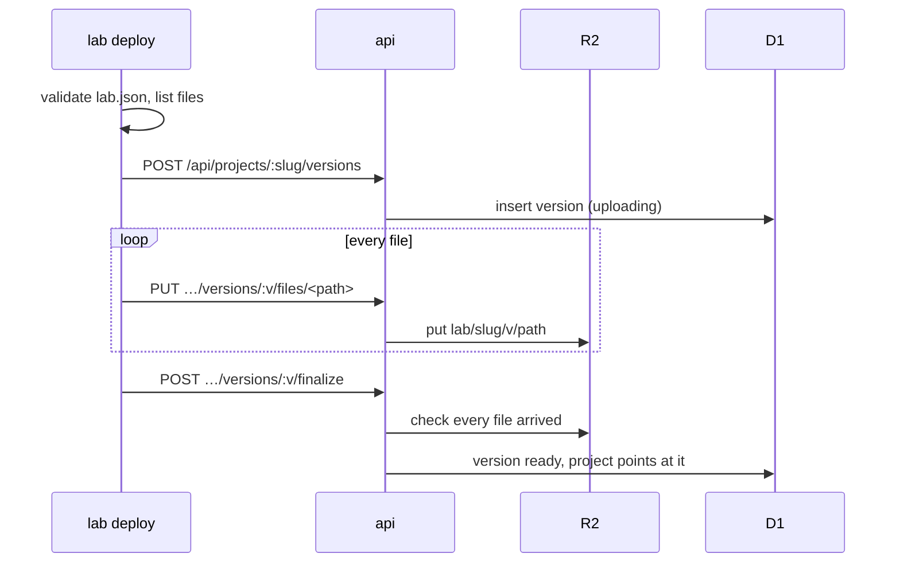

# aninir.com architecture

aninir.com is a small platform that hosts projects. The platform knows how to
store, list and serve projects. It knows nothing about how any project is built.
- **The platform**: the website, the API and the hosting layer. Built once,
  changed rarely. Lives in `apps/` and `packages/`.
- **Projects**: three.js pieces, shaders, games, apps, the 2014 archive. Added
  all the time, in any stack. Live in `projects/` or in their own repos.

The only thing connecting the two is a convention: a folder of built files plus
a `lab.json` that describes it. Projects never depend on the website's code, and
the website never depends on how a project was built.

## Server side

All server code runs as Cloudflare Workers: small functions that run at
Cloudflare's edge, close to the visitor. There is no machine to manage. Three
Workers each have one job.
1. **edge** (`apps/edge`) is the front door. Every request to aninir.com
   reaches it first, and it decides where the request goes:
   - an old 2014 URL gets a 301 redirect to its new place,
   - `/lab/<slug>/…` is served straight from R2 as that project's files,
   - `/api/…` is passed to the API,
   - anything else is passed to the website.
2. **api** (`apps/api`) is the source of truth. It is the only part that writes
   to the database: which projects exist, their details, which version is live,
   who may see them. It is plain REST, and TypeScript also knows its exact
   shapes, so the website calls it through a typed client.
3. **web** (`apps/web`) is the website. It renders pages on the server per
   request, using data it asks the API for.

The three Workers call each other through **service bindings**. These are
internal calls with no network hop and no CORS. The bindings only go one way:
edge→web, edge→api, web→api.

**Storage:**
- **R2** holds the files. Every deploy of a project goes into its own new
  folder, `lab/<slug>/<version>/`, and is never overwritten.
- **D1** (SQLite) holds the facts, such as "project X is live at version 7,
  unlisted".

Deploying a project means uploading a new folder and then telling the API "this
version is live now". Rolling back means pointing at an older version. Nothing
is overwritten in place, so a bad deploy is never destructive.

## Client side

There are two kinds of client code, and they are deliberately different.
1. **The website** (Astro). Pages arrive as finished HTML, already filled with
   project data from the API. That makes them fast, easy for search engines to
   read, and readable with no JavaScript at all. JavaScript is added only where
   something is interactive; Astro calls these "islands". The gallery always
   reflects what is in the database, so a new upload shows up without
   rebuilding the site.
2. **Projects.** Each one is a standalone web app that owns its whole page. At
   `/lab/sunshine/` the browser just gets that project's `index.html`, JS,
   shaders and textures, exactly as they were built. The website's code does
   not load there. Each project picks its own libraries and versions, so a
   three.js r104 piece and a 2026 WebGPU piece never conflict.

## How a visit works

## How adding a project works

After that the project is at `/lab/<slug>/`, and in the gallery if its
visibility is `listed`. See [projects.md](projects.md) for the `lab.json`
fields and build conventions.

## Four ideas behind the design

- **Separation through a contract.** The platform and projects only share the
  `lab.json` format, so either side can change freely.
- **Immutable deploys.** New versions are added and the live one is a pointer,
  which gives instant rollback and safe previews.
- **One owner of writes.** Only the API changes data, so there is one place to
  validate and secure.
- **Same origin.** Everything is served from aninir.com, so there is no CORS
  trouble for WebGL assets and no subdomains to manage.

In one line: the platform hosts, projects are just folders, and `lab.json`
connects them.
