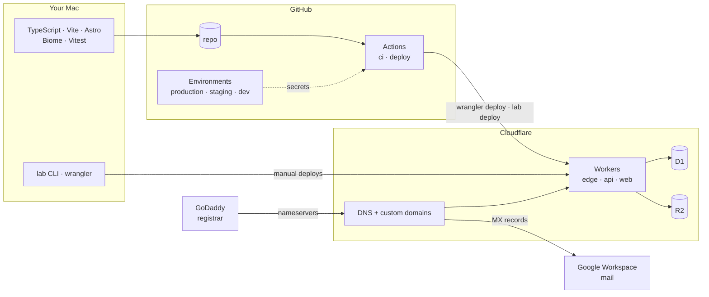

# The stack

Every tool and service in this repo: what it does here, and why it was chosen
over the alternatives. For how the pieces fit at runtime, see
[architecture.md](architecture.md).

## Approach in five lines

1. **Edge-first and serverless.** All code runs as Cloudflare Workers in data
   centers near the visitor. There are no servers, containers or regions to
   manage, and idle costs nothing.
2. **One platform, many projects, one contract.** The platform hosts; projects
   are folders with a `lab.json`. Neither side knows the other's internals.
3. **Immutable deploys.** Every upload is a new version folder; "live" is a
   pointer. Rollback and previews come for free.
4. **Types end to end.** One zod schema and the API's own route types flow into
   the CLI and the website. A breaking change fails the typecheck, not
   production.
5. **Environments are config, not copies.** One codebase; `dev`, `staging` and
   `production` differ only in wrangler config and secrets, chosen by branch.

## Runtime: Cloudflare

| Tool                     | Role here                                                  | Why                                                                                                                                                                                   |
| ------------------------ | ---------------------------------------------------------- | ------------------------------------------------------------------------------------------------------------------------------------------------------------------------------------- |
| **Workers**              | Runs `edge`, `api` and `web`.                              | V8 isolates start in about a millisecond, so there are no cold starts or servers. The free tier covers this site. Unlike Pages, a Worker can own URL paths and use bindings directly. |
| **Service bindings**     | `edge` → `web`/`api`, `web` → `api`.                       | Worker-to-Worker calls inside Cloudflare: no network hop, no public URL, no CORS, no auth between them. Each Worker still deploys on its own.                                         |
| **D1**                   | The registry: projects and versions.                       | SQLite at the edge. Relational data with real SQL and migrations, without running a database. Small, structured, read-heavy: exactly D1's profile.                                    |
| **R2**                   | Every project file, and shared heavy assets.               | S3-compatible storage with no egress fees, which matters for textures, models and video. No 25 MB per-file limit like static assets have.                                             |
| **DNS + custom domains** | `aninir.com`, `staging.`, `dev.`.                          | A Worker attached as a custom domain gets DNS and a TLS certificate automatically. MX and SPF for mail are never touched.                                                             |
| **wrangler**             | Cloudflare's CLI: local dev, deploys, secrets, migrations. | The official tool. `wrangler dev` runs all three Workers locally in the real runtime (workerd), with local D1 and R2.                                                                 |

## Server code

| Tool     | Role here                                   | Why                                                                                                                                                                                                                      |
| -------- | ------------------------------------------- | ------------------------------------------------------------------------------------------------------------------------------------------------------------------------------------------------------------------------ |
| **Hono** | Routing in `api` and `edge`.                | Tiny and built for edge runtimes, on standard `Request`/`Response`. Its typed client (`hc`) turns the API's routes into a typed SDK with no code generation. Express doesn't run on Workers; tRPC would hide plain REST. |
| **zod**  | Validates `lab.json` and every API request. | One schema gives runtime validation, TS types, and the JSON Schema that editors use to autocomplete `lab.json`.                                                                                                          |

## Website

| Tool                    | Role here                                                 | Why                                                                                                                                                                                                                                                 |
| ----------------------- | --------------------------------------------------------- | --------------------------------------------------------------------------------------------------------------------------------------------------------------------------------------------------------------------------------------------------- |
| **Astro**               | The site in `apps/web`, rendered on a Worker per request. | Content-first: pages are HTML with zero JavaScript by default, and interactivity is opt-in "islands" (the shader header). Rendered per request, so new deploys appear without a rebuild. Next.js would bring a React runtime the site doesn't need. |
| **@astrojs/cloudflare** | Runs Astro on Workers.                                    | Uses Cloudflare's Vite plugin, so `astro dev` also runs inside workerd. `CLOUDFLARE_ENV` picks the environment at build time.                                                                                                                       |

## Projects

| Tool         | Role here                                         | Why                                                                                                                                                               |
| ------------ | ------------------------------------------------- | ----------------------------------------------------------------------------------------------------------------------------------------------------------------- |
| **Vite**     | Builds the projects that need a build.            | The standard modern bundler: instant dev server, native TypeScript and GLSL-friendly imports, small output. Optional: `shader-garden` ships with no build at all. |
| **three.js** | 3D in `particle-field` and `let-the-sunshine-in`. | Pinned per project (r104 and r186 side by side). Shared code becomes a package only once two projects need it.                                                    |

## Code and quality

| Tool                | Role here                                     | Why                                                                                                                                                                      |
| ------------------- | --------------------------------------------- | ------------------------------------------------------------------------------------------------------------------------------------------------------------------------ |
| **TypeScript 7**    | All platform code, strict mode.               | TS 7 is the native (Go) compiler, about 10× faster. The flags (`erasableSyntaxOnly`, `verbatimModuleSyntax`) keep code runnable by Node directly, without a build step.  |
| **Node 24**         | Runs the tooling and the `lab` CLI.           | Current LTS. It runs `.ts` files natively, so the CLI has no build. Installed in `~/.local/node` because there's no Homebrew.                                            |
| **pnpm workspaces** | One repo, many packages.                      | Strict dependencies (a package can't use what it didn't declare), a shared store, fast installs. Projects pin their own versions. Turborepo is unnecessary at this size. |
| **Biome**           | Lint and format in one tool.                  | One Rust binary and one config instead of ESLint + Prettier and their plugins, and far faster. `biome ci` in CI.                                                         |
| **Vitest**          | Unit tests for the parts that break silently. | Vite-native, fast, Jest-compatible API. Tests cover the schema, routing, the legacy URL map and the CLI's file matching.                                                 |

## Delivery

| Tool                    | Role here                                                                 | Why                                                                                                                                                             |
| ----------------------- | ------------------------------------------------------------------------- | --------------------------------------------------------------------------------------------------------------------------------------------------------------- |
| **GitHub**              | The repo.                                                                 | Where the code already was.                                                                                                                                     |
| **GitHub Actions**      | `ci.yml` checks every push and PR. `deploy.yml` deploys whatever changed. | It sits next to the code and is free for this use. The deploy job is only `scripts/deploy-platform.sh` and `lab deploy`, so it runs the same way from a laptop. |
| **GitHub Environments** | `production`, `staging`, `dev`.                                           | Per-environment secrets and variables (`LAB_DEPLOY_TOKEN`, `LAB_API`). The branch picks the environment. Production can require a manual approval.              |
| **lab CLI**             | Validates and deploys projects, rolls back.                               | The contract's only client. Plain `fetch` to the API; no Cloudflare credentials needed to deploy a project, just the lab's deploy token.                        |

## Domain and mail

| Service              | Role here                 | Why                                                                                              |
| -------------------- | ------------------------- | ------------------------------------------------------------------------------------------------ |
| **GoDaddy**          | Registrar for aninir.com. | Where the domain was bought. Its nameservers point to Cloudflare, so all DNS lives in one place. |
| **Google Workspace** | Mail on aninir.com.       | Independent of the site. Its MX and SPF records stay as they are.                                |

## Environments

| Branch    | Environment | URL                         | Data                                         |
| --------- | ----------- | --------------------------- | -------------------------------------------- |
| `dev`     | dev         | dev.aninir.com              | `aninir-dev` D1, `aninir-lab-dev` R2         |
| `staging` | staging     | staging.aninir.com          | `aninir-staging` D1, `aninir-lab-staging` R2 |
| `master`  | production  | aninir.com                  | `aninir` D1, `aninir-lab` R2                 |
| any       | local       | localhost:8787 (`pnpm dev`) | `.wrangler/state`                            |

Each environment has its own data and its own tokens, so nothing done on dev or
staging can touch production. Dev and staging send `X-Robots-Tag: noindex` on
every response, so search engines never index them. Work flows
`dev → staging → master` through pull requests.
